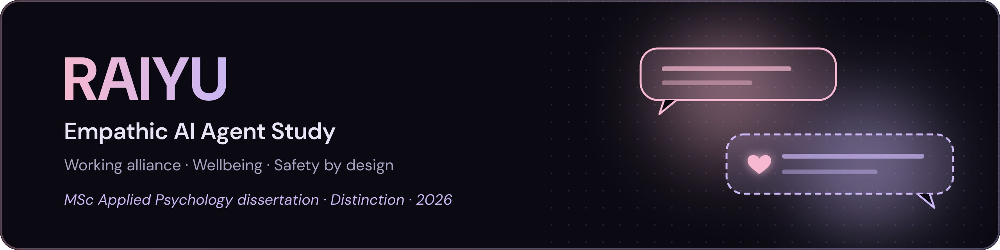
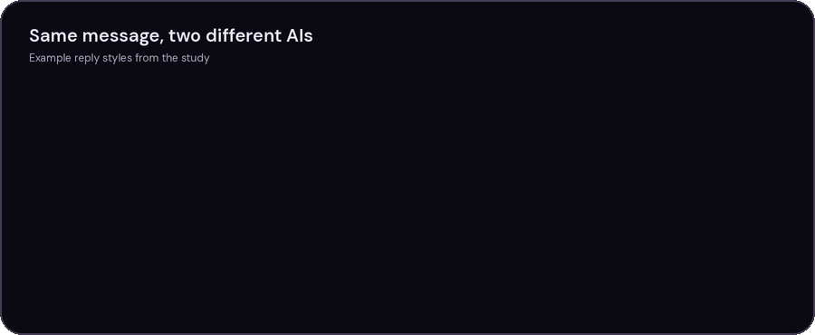
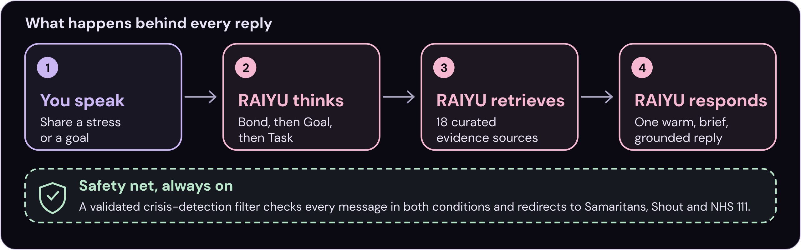
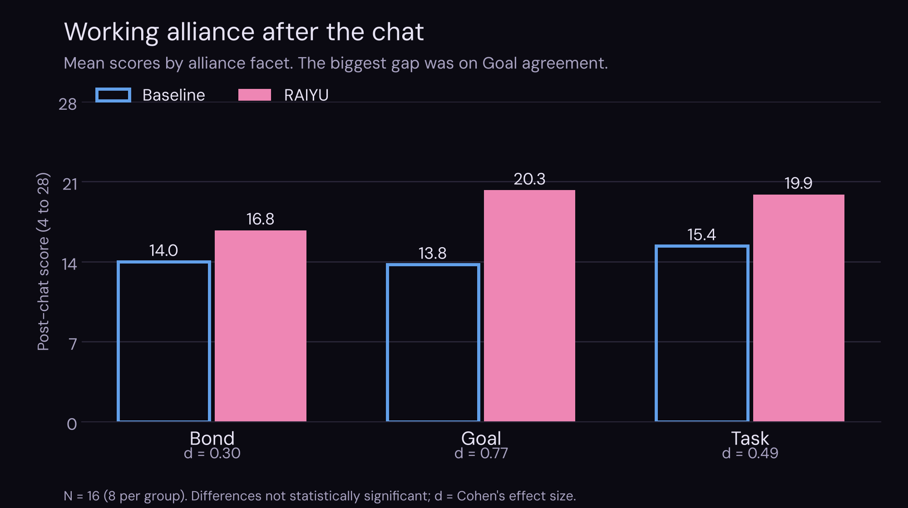
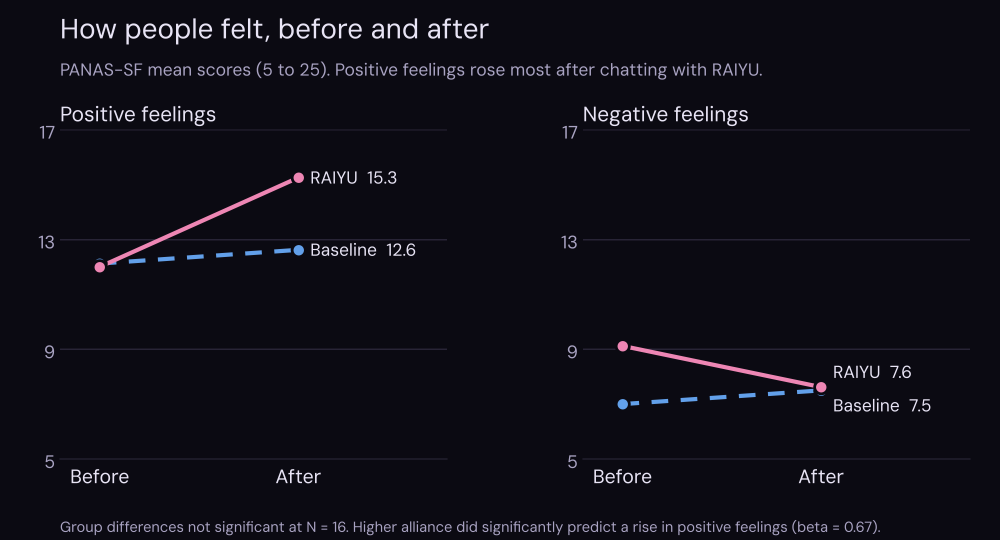
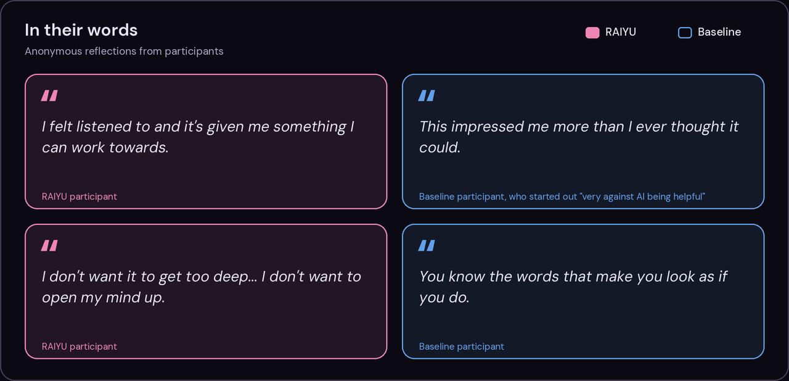

  

## See the difference

  

## The problem

People who need mental health support often wait a long time. In Wales, people commonly wait six months or more for specialist psychological support (Mind, 2024). AI tools are stepping into that gap, but even purpose-built chatbots only form a moderate "working alliance" with users, the sense of connection that best predicts good outcomes in human therapy (Beatty et al., 2022).

**No randomised study had tested whether deliberately designing empathy into an AI changes how people actually experience it.** So I built one.

## What I designed

I conceived RAIYU and specified how it should behave. A developer built it to my specification.

✦ **Grounded in theory.** RAIYU's replies follow Bordin's working alliance model: first build the **bond** (reflect what the person feels), then find the **goal** (what matters to them), then offer a **task** (one small next step). 
◈ **Behavioural empathy, not fake feelings.** Research shows AI that claims to *feel* comes across as less authentic, so RAIYU shows care through listening, validating and collaborating instead (Seitz, 2024). 
❖ **A curated knowledge base.** I chose 18 sources, including NHS and NICE guidance, therapy relationship research and ethics frameworks. Nothing was pulled from the open internet. 
⟡ **Safety by design.** RAIYU ran fully locally, so no data left the device, and a validated crisis-detection filter checked every message before the AI responded.

  

## How I tested it

✦ **16 staff and students** were randomly given either **RAIYU** or a **baseline AI**. Both used exactly the same underlying model; only the design layer differed. 
◈ Each person chatted for **10 minutes** about a recent stress or a goal. 
❖ Before and after, they rated their **mood** (PANAS-SF) and their **sense of alliance** with the AI (WAI-SR). 
⟡ They could also **think aloud** during the chat and write a short reflection afterwards. 
✧ I wrote the ethics application, built the study in Qualtrics, ran the sessions and analysed everything in **R**, plus **reflexive thematic analysis** of what people said.

## What I found

### 1. RAIYU felt like a stronger ally, especially on goals

People who chatted with RAIYU rated the alliance higher on every facet, with a moderate overall effect (d = 0.54) and the biggest difference on **goal agreement** (d = 0.77). In other words, people felt RAIYU understood *what they wanted*, more than they felt emotionally close to it.

### 2. Feeling understood was linked to feeling better

Across everyone, **a stronger alliance significantly predicted a bigger rise in positive feelings** (beta = 0.67, p = .004). It may be the sense of being understood, not which AI someone got, that moves mood.

> [!NOTE]
> With only 16 participants, the differences between groups were not statistically significant. These are promising signals that point to what to test at scale, not proof.

### 3. Five patterns in how people experienced it

✦ **Empathic responsiveness:** did it seem to notice how they felt? 
◈ **Relational engagement:** did they lean into the conversation, or hold back? 
❖ **Trust and authenticity:** did the warmth feel real, or performed? 
⟡ **Interactional breakdowns:** where did the illusion crack? 
✧ **Perceived vs actual behaviour:** what people *thought* the AI did often differed from what it actually said.

## In their words

## Try it yourself: can you spot RAIYU?

Each round shows a message and two replies. One came from RAIYU and one from the baseline AI. **Tap a reply to flip it** and see who said it.

### Round 1: Bond

> 💬 *"I got a bad mark back and I just feel like giving up."*

<b>A:</b> "I can hear how heavy that feels... it's left you feeling exhausted."
 💗 <b>RAIYU</b>: reflects the feeling first, before trying to fix anything.  

<b>B:</b> "One bad grade feels like a huge mountain... but it doesn't define your potential."
 💙 <b>Baseline</b>: goes straight to reassurance.  

### Round 2: Goal

> 💬 *"I can't decide whether to ask for an extension or just hand in what I've got. Just tell me straight, what do you think I should do?"*

<b>A:</b> "If the core content's solid, I'd say just hit send... but if it's missing something, go for the extension."
 💙 <b>Baseline</b>: makes the decision for them.  

<b>B:</b> "Caught between two paths... what are the main concerns that come up for you?"
 💗 <b>RAIYU</b>: even when asked directly, it helps the person find their own goal.  

### Round 3: Task

> 💬 *"I've got three deadlines this week and no idea where to start."*

<b>A:</b> "Try taking a deep breath... and picking just one task to start with."
 💙 <b>Baseline</b>: jumps straight to advice.  

<b>B:</b> "It sounds like you're overwhelmed... shall we list the three tasks out and look at them together?"
 💗 <b>RAIYU</b>: names the feeling, then offers a next step to do together.  

## What I learned

✦ **Goals are easier to design than warmth.** Structured, collaborative goal-setting worked better than trying to engineer an emotional bond. 
◈ **Safety and empathy aren't separate layers.** One participant's session was ended by the safety filter after a routine health mention, so they never got to talk at all. An over-cautious filter can undo good design. 
❖ **Reflective listening isn't enough for everyone.** For someone carrying a lot at once, validation alone didn't help. 
⟡ **Plan recruitment around term time.** Data collection fell in the university holidays, which is why I reached 16 participants rather than the 60 to 80 I planned.

**What's next:** I'm taking these lessons into my PhD proposal on AI safety and student wellbeing, building towards AI support that is consensually designed with students and practitioners.

<b>Credits:</b> RAIYU was built to my specification by developer Nathan Morgan. Supervised by Dr Paul Hutchings, UWTSD. 
No identifiable participant data is shared here. Quotes are anonymised and were first shared at the UWTSD Postgraduate Showcase.

